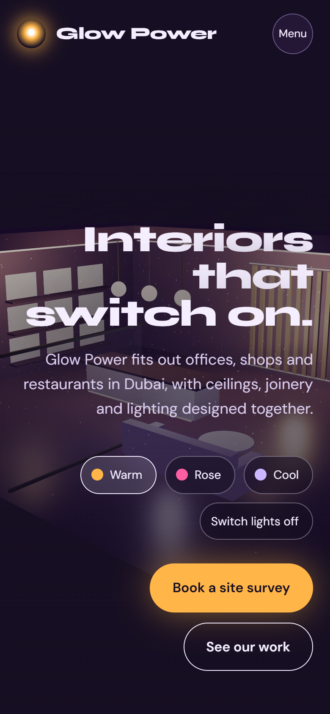
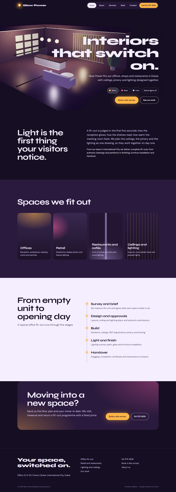

# Glow Power Building Contracting LLC

A multi-page static concept website for **Glow Power Building Contracting LLC**, a Dubai interior fit-out contractor specializing in offices, retail shops, restaurants, custom joinery, gypsum ceilings, and architectural lighting—based in International City, Dubai.

Built around a dramatic **night-plum & luminous lighting palette**, the centerpiece is an interactive **Three.js 3D office interior** where cove lights, illuminated display shelves, and pendant fixtures switch on sequentially—with live controls to swap lighting color palettes (**Warm**, **Rose**, **Cool**) or toggle the lights off.

---

## Screenshots

### Desktop — Interactive 3D Lit Interior Hero


### Pages & Responsive Views

| Fit-Out Services | Our Work |
| :---: | :---: |
|  |  |

| Book a Site Survey | Mobile Responsive (`390×844`) |
| :---: | :---: |
|  |  |

<details>
<summary>View Full Landing Page Screenshot</summary>



</details>

---

## Key Features

- **Interactive Three.js 3D Interior Lighting Scene (`assets/js/scene.js`)**:
  - Built with bundled **Three.js r128** (`assets/js/vendor/three.min.js`) using ACES Filmic tone mapping (`ACESFilmicToneMapping`).
  - Features an architectural room with bulkhead ceilings, illuminated shelving, cove strips, and pendant lights that power on sequentially.
  - **Live Lighting Controls**:
    - Palette switcher chips: **Warm** (`#FFB547`), **Rose** (`#FF5FA2`), and **Cool** (`#CBB8FF`).
    - **Switch lights off / on** toggle button (`[data-lights]`).
  - Compact `data-scene="mini"` interior scenes on inner pages and `prefers-reduced-motion` support.
- **Fit-Out Workflow & Scope**: Covers Office Fit-Out, Retail & Restaurants, and Ceilings & Lighting across a 5-stage delivery timeline (Survey → Design & Approvals → Build → Light & Finish → Handover).
- **Validated Site Survey Form (`assets/js/main.js`)**: Client-side field validation with accessible `aria-live` confirmation messages (ready to wire to Formspree or any email backend).
- **Zero Build Step**: Pure HTML5, CSS3, and vanilla JavaScript.

---

## Pages Included

| File | Page | Highlights |
| :--- | :--- | :--- |
| `index.html` | **Home** | Interactive 3D interior with Warm/Rose/Cool lighting palettes, space categories, 5-stage fit-out timeline |
| `about.html` | **About** | Lighting-first fit-out philosophy, one-programme scheduling, fixed-price scope, light-tested handovers |
| `services.html` | **Services** | Deep dives into Office Fit-Out, Retail & Restaurants, and Ceilings & Lighting |
| `projects.html` | **Our work** | Stylized CSS lighting-gradient cards for Offices, Boutiques, Cafés, and Boardrooms |
| `contact.html` | **Book a site survey** | International City office details, callback request form, embedded Google Map |
| `404.html` | **Not Found** | Custom themed 404 page (`Lights on, nobody home.`) |

---

## Design System & Typography

- **Fonts**: `Syne` (expressive geometric display headings) and `DM Sans` (body copy) via Google Fonts.
- **Color Tokens** (`assets/css/style.css`):
  - Night Background: `#160E22`
  - Plum Surface: `#2A1A3D` / `#3A2850`
  - Warm Amber Glow: `#FFB547`
  - Neon Rose Accent: `#FF5FA2`
  - Cool Lilac Accent: `#CBB8FF`
  - Mist Foreground: `#F4EEFF`

---

## Project Structure

```text
glow-power-interiors/
├── index.html
├── about.html
├── services.html
├── projects.html
├── contact.html
├── 404.html
├── favicon.svg
├── screenshots/
│   ├── home-hero.png
│   ├── home-full.png
│   ├── services.png
│   ├── projects.png
│   ├── contact.png
│   └── mobile-home.png
└── assets/
    ├── css/
    │   └── style.css
    └── js/
        ├── main.js
        ├── scene.js
        └── vendor/
            └── three.min.js
```

---

## Run Locally

No build tools required:

```bash
git clone https://github.com/hassaankhalid225/glow-power-interiors.git
cd glow-power-interiors

# Using Node.js
npx serve .

# Or using Python
python -m http.server 8000
```

---

## Deployment & Form Setup

- **Static Hosting**: Deploy directly to **Vercel**, **Netlify**, or **GitHub Pages** with no build command and `.` as the output directory.
- **Connecting Email Form Submissions**: Currently the contact form displays an instant client-side confirmation message. To receive enquiries by email (e.g., via Formspree), add `action` and `method="POST"` to the `<form>` in `contact.html` and remove the `data-contact-form` attribute.

---

## Notes

- Contact details (`Office 12, R-02, France Cluster, International City, Dubai`, `04 575 1809`) come from public business directory listings.
- Project descriptions and visual cards are sample concept material for review.
