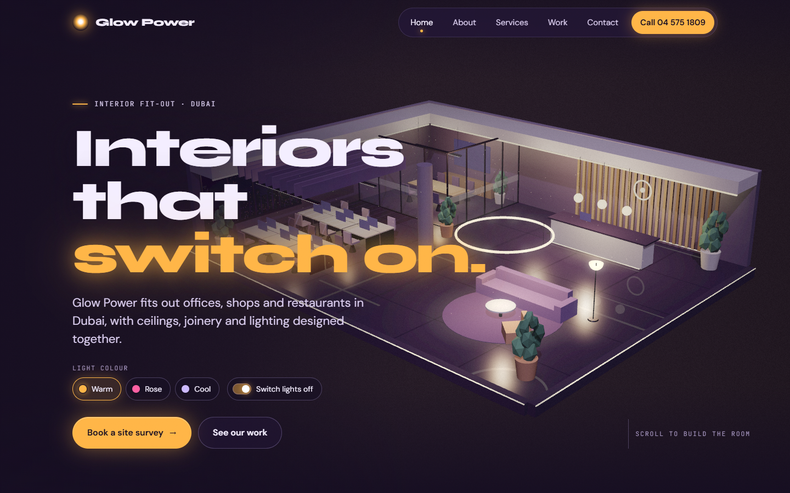
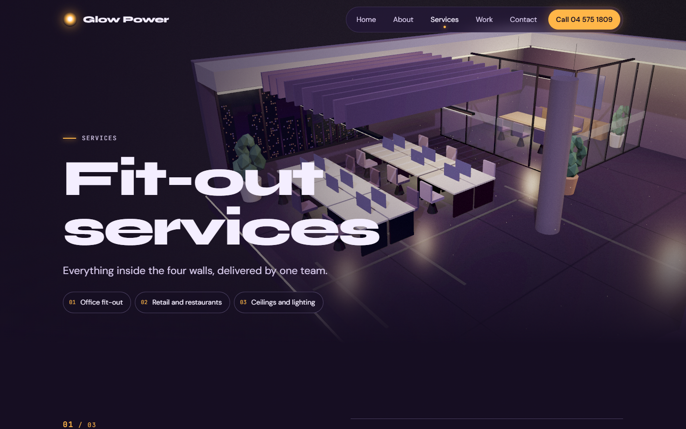
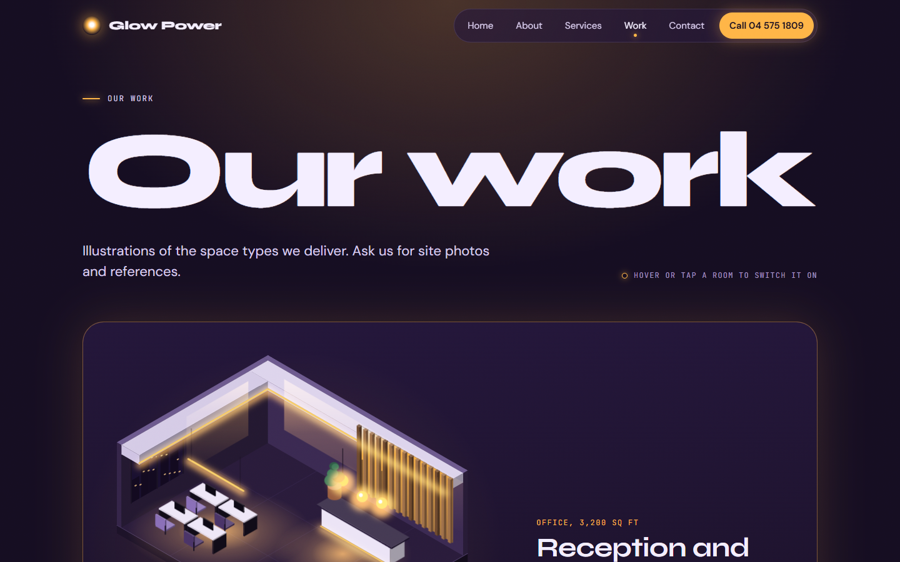
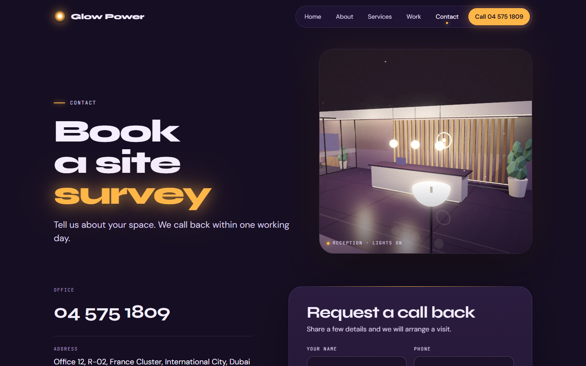

# Glow Power Building Contracting LLC

A multi-page static concept website for **Glow Power Building Contracting LLC**, a Dubai interior fit-out contractor specialising in offices, retail shops, restaurants, custom joinery, gypsum ceilings and architectural lighting, based in International City, Dubai.

The site is built around a **night-plum palette lit in amber, rose or lilac**. Its centrepiece is a hand-built **Three.js 3D office interior** that you watch being fitted out as you scroll, from empty shell to opening day, before its lights switch on zone by zone.

---

## Screenshots

### Desktop: the lit 3D interior hero


### Pages & Responsive Views

| Fit-Out Services | Our Work |
| :---: | :---: |
|  |  |

| Book a Site Survey | Mobile (`375×812`) |
| :---: | :---: |
|  |  |

<details>
<summary>View Full Landing Page Screenshot</summary>


</details>

---

## Key Features

- **Cinematic 3D interior (`assets/js/scene.js`)**, built with the bundled **Three.js r128** (`assets/js/vendor/three.min.js`) and no add-ons:
  - A detailed open-plan office: glass meeting room with frosted manifestation band, linear pendants, cove LED strips under gypsum bulkheads, acoustic felt baffles, a slatted timber wall with backlight and a glowing ring mark, reception counter with pendant globes, desk clusters with chairs and monitors, a lounge with a light ring, a floor lamp, plants, a structural column and a window onto a city skyline at night.
  - Polished floor with soft reflections of every light, light pools on the floor and wash down the walls, soft shadows and contact shadows, drifting dust in the light.
  - **Hand-written post-processing**: bright-pass bloom at two blur scales, vignette and film grain, using `WebGLRenderTarget` + `ShaderMaterial` (multisampled on WebGL2).
  - **Choreographed switch-on**: the lighting zones (cove, reception, meeting room, workspace, lounge, floor kick) flick on in sequence with a short filament flicker, and their glow spreads into the room.
  - **Light colour controls**: Warm (`#FFB547`), Rose (`#FF5FA2`) and Cool (`#CBB8FF`) chips cross-fade the whole room *and* the page accent colour (a registered CSS `@property --accent`), and the choice is remembered across pages. A switch toggles the lights off and on (`[data-lights]`, `aria-pressed`).
  - Cursor-follow light and gentle camera parallax on desktop.
- **Scroll story on the home page**: the 3D canvas is pinned while the five fit-out stages scroll past. The camera glides between shots as the room is rewound to an empty shell, measured on a grid, drawn up as a plan, built (bulkheads, baffles, glass, joinery), furnished (furniture drops into place) and finally lit, ending on the handover shot. A progress rail tracks the stages.
- **Isometric room illustrations** (inline SVG) on the Work page, the home page and the services chapters: four rooms (office, boutique, café, boardroom) whose lights flicker on when you hover or focus them (or scroll them into view on touch screens). Each Work card has its own light-colour swatches.
- **Brand details**: a filament-warming loading screen (first visit per session, about 1.2 s, CSS only, never blocks), a "lights dim" page transition, light-edge hover borders that follow the pointer, and glowing focus states.
- **Inner pages with their own layouts**: framed 3D views on About (lounge) and Contact (reception), a full-bleed workspace scene and sticky service chapters on Services, a type-led gallery on Work, and a flickering after-hours scene on the 404 page.
- **Validated contact form (`assets/js/main.js`)**: client-side validation with `aria-live` status messages (ready to wire to WhatsApp via `data-whatsapp`, or to Formspree).
- **Performance and accessibility**: rendering pauses when the canvas is off-screen or the tab is hidden; device pixel ratio is capped (2 on desktop, 1.5 with post-processing or on phones); phones get a lighter scene (fewer props and lights, no shadows or post-processing). `prefers-reduced-motion` shows a still, finished frame with no scroll camera, flicker, loader or transitions, while all controls still work. If WebGL is unavailable, the home hero shows an isometric illustration instead.
- **Zero build step**: plain HTML5, CSS3 and vanilla JavaScript.

---

## Pages Included

| File | Page | Highlights |
| :--- | :--- | :--- |
| `index.html` | **Home** | Pinned 3D scroll story of a fit-out, light colour and switch controls, spaces we fit out |
| `about.html` | **About** | Framed 3D lounge, the site team, "three switches" client promises |
| `services.html` | **Services** | Full-bleed 3D workspace header, sticky chapters for Office, Retail & Restaurants, Ceilings & Lighting |
| `projects.html` | **Our work** | Isometric gallery whose rooms light up on hover, per-card light colours |
| `contact.html` | **Book a site survey** | Framed 3D reception, contact details, call-back form, embedded Google Map |
| `404.html` | **Not Found** | `Lights on, nobody home.` over a dim scene with one flickering light |

---

## Design System & Typography

- **Fonts**: `Syne` (display), `DM Sans` (body) and `JetBrains Mono` (labels) via Google Fonts.
- **Colour tokens** (`assets/css/style.css`):
  - Night background: `#160E22`
  - Plum surfaces: `#24173A` / `#33234B` / `#45315F`
  - Accent (animated): Warm `#FFB547`, Rose `#FF5FA2`, Cool `#CBB8FF`
  - Mist foreground: `#F4EEFF`

---

## Project Structure

```text
glow-power-interiors/
├── index.html
├── about.html
├── services.html
├── projects.html
├── contact.html
├── 404.html
├── favicon.svg
├── screenshots/
│   ├── home-hero.png
│   ├── home-full.png
│   ├── services.png
│   ├── projects.png
│   ├── contact.png
│   └── mobile-home.png
└── assets/
    ├── css/
    │   └── style.css
    └── js/
        ├── ui.js        (light state, scroll story, transitions, hovers)
        ├── main.js      (menu, header, contact form)
        ├── scene.js     (Three.js interior + post-processing)
        └── vendor/
            └── three.min.js
```

---

## Run Locally

No build tools required:

```bash
git clone https://github.com/hassaankhalid225/glow-power-interiors.git
cd glow-power-interiors

# Using Node.js
npx serve .

# Or using Python
python -m http.server 8000
```

---

## Deployment & Form Setup

- **Static hosting**: deploy directly to **Vercel** (preset "Other", no build command), **Netlify** or **GitHub Pages** with `.` as the output directory.
- **Form submissions**: the contact form validates on the client and shows an instant confirmation message. Add a `data-whatsapp="971XXXXXXXXX"` attribute to the `<form>` to open WhatsApp with the message, or add `action` and `method="POST"` (e.g. Formspree) and remove `data-contact-form` to receive enquiries by email.

---

## Notes

- Contact details (`Office 12, R-02, France Cluster, International City, Dubai`, `04 575 1809`) come from public business directory listings.
- Project descriptions and illustrations are sample concept material for review.
